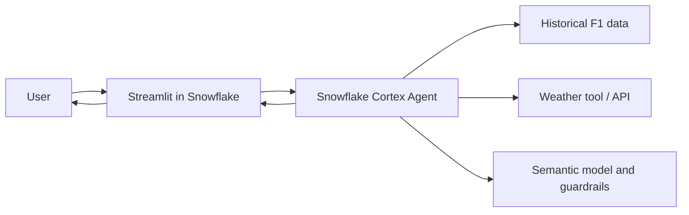

# F1 Historical Intelligence Agent

An AI-powered Formula 1 analytics chatbot built with Streamlit in Snowflake and
Snowflake Cortex Agents. The app combines historical race data with circuit and
weather context to answer natural-language questions about drivers, races, and
performance across eras.

> This repository contains the Streamlit app and deployment templates.
> The Snowflake agent, data, credentials, and API keys remain private.

## What it does

- Answers questions about historical Formula 1 drivers and race results.
- Adds circuit and race-day weather context.
- Supports comparative questions across different racing eras.
- Uses a Cortex Agent to coordinate structured data and external tools.
- Shows generated SQL for transparency without executing it in the UI.
- Maintains a conversational history within the Streamlit session.

Example questions:

- Did it rain during the 1998 Belgian Grand Prix?
- Compare the careers of Michael Schumacher and Lewis Hamilton fairly.
- Was it a wet track at the 2023 Bahrain Grand Prix?
- Who won the 2021 German Grand Prix, and what was the weather like?

## Architecture



The Streamlit application submits conversation history through
`SNOWFLAKE.CORTEX.DATA_AGENT_RUN`. The agent handles planning and tool use, then
returns a grounded response for the chat interface.

## Technology

- Python 3.11
- Streamlit in Snowflake
- Snowflake Snowpark
- Snowflake Cortex Agents
- SQL and semantic models
- Historical Formula 1 and weather data

## Repository structure

```text
.
├── streamlit_app.py          # Chat application
├── environment.yml           # Warehouse-runtime dependencies
├── snowflake.yml.example     # Sanitized Snowflake CLI template
├── .gitattributes
├── .gitignore
├── LICENSE
└── README.md
```

## Configure the app

1. Create and configure a Cortex Agent in Snowflake.
2. In `streamlit_app.py`, replace the placeholder with the fully qualified
   agent name:

   ```python
   AGENT_NAME = "YOUR_DATABASE.YOUR_SCHEMA.F1_HISTORICAL_AGENT"
   ```

3. Ensure the Streamlit owner role can use Cortex Agents and access the agent
   object and its underlying data sources.
4. Keep credentials and external API keys in Snowflake secrets, not in source
   control.

## Deploy

### Snowsight

Create a Streamlit app in Snowsight, upload `streamlit_app.py` and
`environment.yml`, set the agent name, and run the app with an appropriately
restricted owner role.

### Snowflake CLI

Copy `snowflake.yml.example` to `snowflake.yml`, fill in your own identifiers,
and deploy:

```bash
snow streamlit deploy f1_historical_intelligence_agent --replace
```

The real `snowflake.yml` is ignored because it can contain account-specific
object names.

## Security decisions

- No credentials, account identifiers, or API secrets are committed.
- User-facing errors are generic; detailed exceptions are written to logs.
- SQL included in an agent response is displayed but never automatically run
  by the Streamlit layer.
- The application should run under a least-privilege Snowflake role with
  read-only access to the required datasets.
- The agent should enforce query limits and restrict expensive bulk weather
  lookups.

## Known limitations

- The app requires a configured Cortex Agent and cannot run as a standalone
  local chatbot without Snowflake.
- Weather coverage depends on the connected weather source.
- Cross-era comparisons depend on the metrics and normalization logic provided
  by the underlying semantic model.

## Future improvements

- Stream agent responses into the interface.
- Add visual race and driver comparison charts.
- Add citations showing the datasets and tools used for each answer.
- Add automated tests for response parsing and SQL-display behavior.

## License

Released under the [MIT License](LICENSE).
